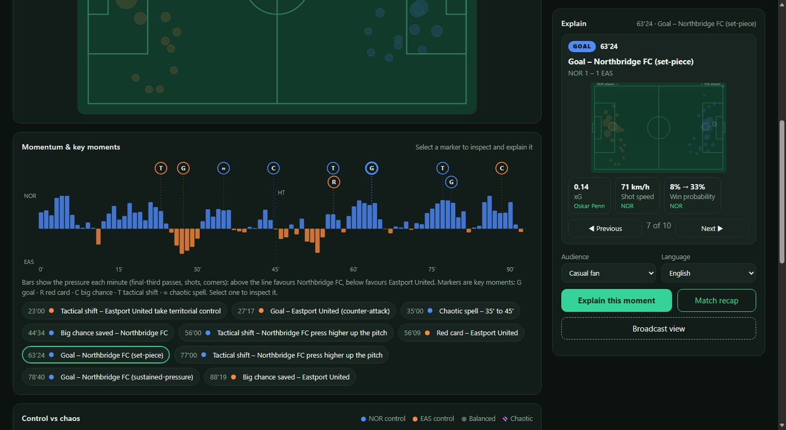
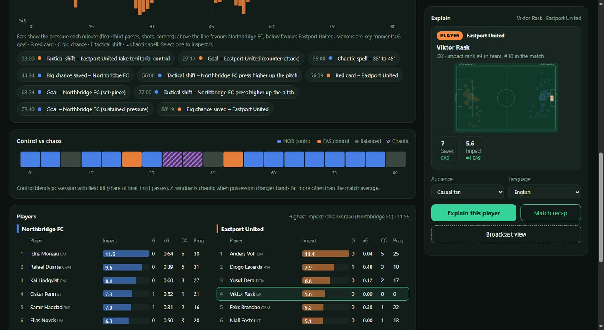
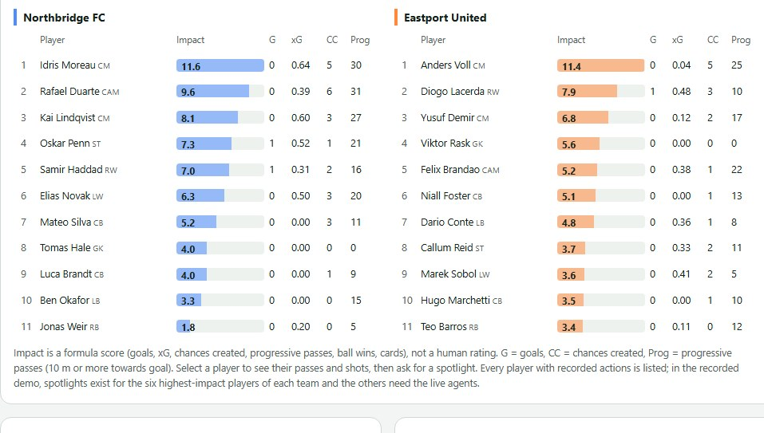
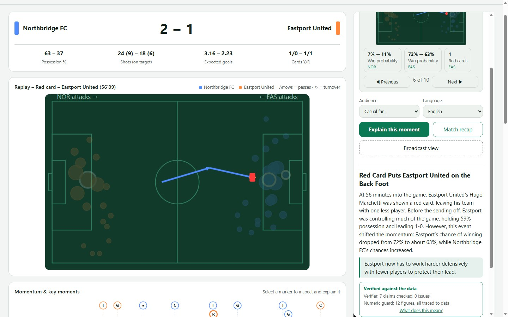
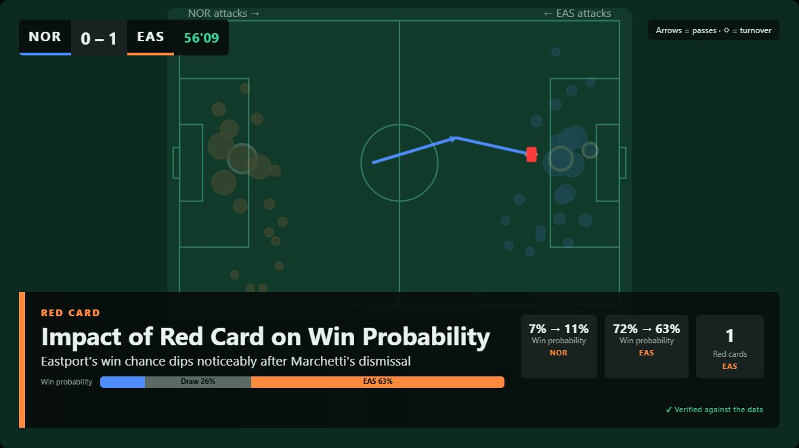

# Match Insights Engine

Microsoft Premier League Hackathon ("Inside the Game") entry.

**Explainable, verifiable AI match intelligence.** It turns synthetic football events into explanations of *why a
moment mattered* for a broadcaster, a coach or a fan, in six languages, and then **checks what the AI wrote**:
the model never owns the numbers. Four agents on Microsoft Foundry write the explanation; computed facts and
deterministic checks decide what reaches the screen.



## Try it in two minutes (no Azure needed)

The repository includes 79 explanations recorded earlier by the real agents, so the whole interface runs without
an Azure account.

```powershell
git clone https://github.com/RodrigoBTX/match-insights-engine.git
cd match-insights-engine
python -m venv .venv
.venv\Scripts\python -m pip install -r requirements.txt     # 66 packages, about 3 minutes
$env:DEMO_ONLY = "1"                                        # never contacts Azure
.venv\Scripts\python -m uvicorn app.main:app --port 8000
```
On macOS or Linux use `.venv/bin/python` instead of `.venv\Scripts\python`, and `export DEMO_ONLY=1`.
Open http://127.0.0.1:8000. The header badge says **Recorded demo**. Needs Python 3.10 or newer; tested on Windows 11 with Python 3.13, not on macOS or Linux. If port 8000 is busy, use another one with `--port 8001` and open that address.

What to try:
1. Click a marker on the **Momentum** timeline (G goal, R red card, C big chance, T tactical shift, ≈ chaotic spell).
   Its figures and a small replay appear at once on the right. Move on with ◀ ▶ or the arrow keys.
2. Press **Explain this moment**: the recorded explanation appears with its verification mark. Change the
   audience (casual fan, coach, broadcaster) or the language.
3. Press **Broadcast view** for an on-air graphic of the moment, a player or the whole match.
4. Click a square in **Control vs chaos**, or a player in the table, for their figures.







## Microsoft technologies used

- **Microsoft Foundry**: the model deployment (gpt-4.1-mini) and project endpoint used by every agent.
- **Microsoft Agent Framework (Python)**: four agents (Analyst, Narrator, Verifier, Localiser) in a
  `SequentialBuilder` workflow; the Analyst queries the match through **tools**; agent progress is streamed to the UI.
- **Azure Identity**: keyless sign-in through the Azure CLI credential.

Not used: Azure MCP, Fabric, Azure databases, an Azure-hosted deployment (the project runs locally).

## What it does

- **Instant facts, no AI needed.** Possession, expected goals, momentum, win probability, control vs chaos,
  tactical shifts (territory and press height), pass quality, player impact and the role of each goal
  (opening, equaliser, match-winning) are computed in `app/analytics.py` and `app/players.py`.
- **Four agents explain it on request**: the Analyst, a Narrator, a Verifier that checks each claim, and a
  Localiser for the audience and one of six languages (EN, PT, ES, FR, DE, IT).
- **Broadcast view.** An on-air lower third over the replay: a scorebug, a tag, a title and one sentence written by
  the agents, a win-probability bar and a verification mark.

  

- **The figures on screen are computed, not written by the model** (`app/chips.py`): always both teams
  ("63% – 37%", "NOR – EAS"), role-aware (a goalkeeper gets saves), only the labels translated.
- **Real data adapters** for Opta F24 XML and StatsBomb-style JSON (see the limits below).
- **Runs without Azure** from recorded results, labelled as recorded; falls back to them by itself when Azure
  sign-in is not available.

## Why you can trust what it says

Every layer exists because an earlier one failed in a test:

1. **Numbers are computed** from the data. The agents interpret them and query them through tools.
2. **A Verifier agent** checks each claim against the facts.
3. **A deterministic numeric guard** (`app/grounding.py`) checks that every figure in the final text traces to the
   data. It exists because the Verifier alone let wrong figures through in an adversarial test.
4. **Computed goal roles.** A spotlight once called an equaliser "the winning goal" and the Verifier approved it;
   the role is now a fact handed to the agents.
5. **Wording checks the numbers cannot see.** A chaotic spell belongs to both teams, so a headline, graphic
   title or line that names only one is flagged ("Needs a check").
6. **One automatic rewrite.** When a check flags the first draft, the Narrator rewrites it once with the exact
   reason ("verify, then revise"). The better draft is kept, and the page says that a rewrite happened. A rewrite
   costs a second pass, so it roughly doubles the time of the few explanations that need it (about 25 s instead of 10 s).

### Measured quality (first try, no retries)

`python -m scripts.quality_report [--seed N]` runs 49 cases once each (every moment in three audiences, Portuguese
graphics, the recap and six players) and counts the first result. Every run is in `docs/`.

| # | Match | System | Clean on the first draft | Clean after the automatic rewrite |
|---|---|---|---|---|
| 1 | seed 7 (the match used for tuning) | before any fix ([report](docs/quality_report_run1.md)) | 84% (41/49) | no rewrite existed |
| 2 | seed 7 | after prompt fixes ([report](docs/quality_report_run2.md)) | 96% (47/49) | no rewrite existed |
| 3 | seed 7 | + automatic rewrite ([report](docs/quality_report.md)) | 90% (44/49) | 96% (47/49) |
| 4 | **seed 11, not used for tuning** ([report](docs/quality_report_seed11.md)) | same as 3 | 96% (47/49) | 100% (49/49) |
| 5 | **seed 21, not used for tuning** ([report](docs/quality_report_seed21.md)) | final code | 98% (48/49) | 100% (49/49) |

How to read it, and what not to conclude:
- **The same match gave 84%, 96% and 90% on the first draft** in runs 1 to 3: a difference of a few points between
  runs is noise, so do not read 98% against 96% as an improvement.
- Runs 1 and 2 were tuned on the same cases they measure, so they only show that the fixes worked. Seeds 11 and 21
  are **partly** independent: they share the demo match's scripted story (same minutes), only the play and the
  figures differ. Each is one run of 49 cases.
- Run 5 includes two fixes made after run 4 (a retry when the model returns malformed JSON, which had crashed one
  case in run 3, and a headline example for chaotic spells). Run 4 was not repeated.
- **The chaotic spell is the hardest case.** Its first draft passed in 25%, 50%, 25% and 75% of cases in runs 1 to 4
  (4 cases per run), and 4 of 4 on seed 21 after the headline example. Four cases cannot prove the example works.
- A pass means *no detectable error*: no verifier flag, every figure traced, graphic present, no one-sided chaos
  wording, no wrong goal role. It does not mean the writing is good; titles can still be generic.
- **Does the Verifier still catch errors?** `python -m scripts.verifier_probe` plants six errors in a correct text.
  It caught 15 of 18 over three rounds and listed no false alarm on the correct text (counted by keyword).
- **Speed:** a new live explanation takes about 10 to 11 s (median; slowest 17 to 35 s across runs). Recorded
  results and the selection card are instant.
- The recordings in `demo/` are **the best of up to four attempts**, so they show the system at its best; the
  table above is the honest average.
## Run with the live agents

```powershell
az login --use-device-code          # keyless sign-in
copy .env.example .env              # then set FOUNDRY_PROJECT_ENDPOINT and FOUNDRY_MODEL
.venv\Scripts\python -m uvicorn app.main:app --port 8000
```
The badge then says **Live agents**. Without `DEMO_ONLY` the app tries the live agents and falls back to the
recordings if Azure is unavailable. Everything model-related is in `.env`:

```
FOUNDRY_PROJECT_ENDPOINT=https://<resource>.services.ai.azure.com/api/projects/<project>
FOUNDRY_MODEL=<deployment name>
```

- **Another model:** deploy it in Foundry, put its deployment name in `FOUNDRY_MODEL`, restart.
- **Another Azure account or project:** `az login` with that account, set the new endpoint, restart.
- **Another model provider:** the client is created in one place, `client()` in `app/agents.py`.
- All four agents share one model. Authentication is the Azure CLI credential, which suits a local demo; a hosted
  deployment would use a managed identity, which is not implemented.

### Recordings

Each recording is tied to a fingerprint of the demo match; if the generator or the analytics change, old
recordings are ignored instead of being attached to the wrong facts. To re-record, sign in and run
`python -m scripts.pregenerate` (resumable; two pipelines in parallel because three hit the deployment's rate limit).

## Using real match data

Use **Load real event feed** in the UI (or `POST /api/match/upload`). The format is detected from the content.

| Format | Adapter | Status |
|---|---|---|
| StatsBomb-style event JSON | `from_statsbomb` | Written from the documented layout; tested on a small fixture only |
| Opta F24 XML | `from_opta_f24` | Structure, end-coordinate qualifiers and the corner flag checked against the open-source `socceraction` parser; event type ids from a secondary source; tested on a hand-made fixture, never on a real feed |

- **Opta card qualifiers are unconfirmed.** The adapter assumes 31 = yellow, 32 = second yellow, 33 = red.
- F24 carries no player names and no xG that could be confirmed: players appear as `Player <id>`; xG comes from this
  project's distance/angle model.
- Opta has no possession id, so sequences are derived (a new team on the ball, a gap over 12 s, or a ball won).
- Windows with under 10 passes per 5 minutes are never reported as chaotic and cannot produce a tactical shift.
- Thresholds for chaos and tactical shifts were tuned on the synthetic match and need recalibrating on real data.
- Extra time and shoot-outs are not modelled (the analysis assumes about 93 minutes).
- Feeds are untrusted input: XML is parsed with `defusedxml`.
- **The hackathon requires synthetic data**, so the demo uses the synthetic match; do not commit real match files
  (provider data carries its own licence terms).

To support another provider, write a function that returns a `Match` (see `app/schema.py`) and call it from the
upload endpoint in `app/main.py`.

## Known limitations

- The demo match is synthetic, one match only; recordings cover that match only.
- The synthetic match has 11 players per team and no substitutions. A real feed would list every player with recorded
  actions, but entry and exit minutes are not modelled and the adapters ignore substitution events.
- The Verifier is a language model and is not reliable alone; the deterministic checks cover figures and the
  framing cases found so far, not every possible error.
- Titles can be generic and grammar can slip, mostly outside English.
- The labels of the six languages were written without review by native speakers; the long languages (German,
  French) were not checked visually.
- Layout was checked at 390 px and 820 px wide in headless Edge (no horizontal overflow); it was not tried on a real
  phone. Not tested: macOS and Linux, real full matches.
- On a phone the explain panel sits below the charts, so after picking a moment you scroll down to see it.

## Layout

| Path | Purpose |
|---|---|
| `app/schema.py` | Canonical Pydantic event model: the only thing the rest reads |
| `app/generator.py` | Seeded synthetic match with a scripted story |
| `app/analytics.py` | Stats, xG, momentum, win probability, control vs chaos, tactical shifts, key moments |
| `app/players.py` | Player statistics, pass quality, impact |
| `app/agents.py` | The four agents, their tools and prompts, the broadcast graphic |
| `app/grounding.py` | Numeric guard and wording checks |
| `app/chips.py` | Computed key figures (six-language labels) |
| `app/demo.py` | Recorded demo mode |
| `app/adapters.py` | Opta F24 and StatsBomb adapters |
| `app/main.py` | FastAPI endpoints |
| `static/` | HTML, CSS and JS front end |
| `demo/explanations.json` | The 79 recordings |
| `scripts/` | `pregenerate` (record), `quality_report` (measure), `verifier_probe` (does the Verifier still catch errors) |
| `tools/ui/` | Browser test scripts (real clicks and screenshots) |
| `tests/` | pytest suite: `pip install -r requirements-dev.txt`, then `python -m pytest tests -q` |

## License

MIT, see [LICENSE](LICENSE).
